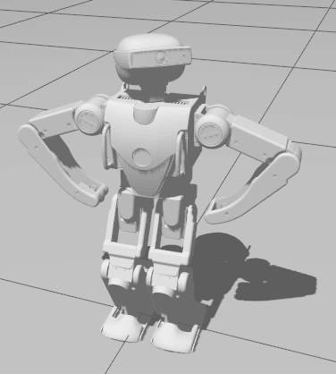
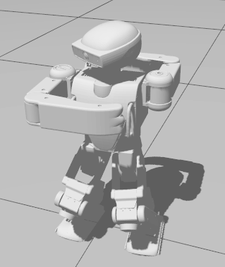

# muriqui_examples

## Setup and launch the Muriqui

Please refer to the [../README.md](../README.md) for instructions on how to setup the environment.

## Publish commands for all joints

Move all joints to the positions set in a CSV file.

Launch nodes using the following command:

```sh
ros2 launch muriqui_examples publish_joint_commands.launch.py
```

### Walking

Launch nodes using the following command:

```sh
# fast walking
ros2 launch muriqui_examples publish_joint_commands.launch.py file:=walking_fast

# slow walking
ros2 launch muriqui_examples publish_joint_commands.launch.py file:=walking_slow
```

### Modify the CSV file

The CSV file is located in [muriqui_examples/config/joint_goals.csv](./config/joint_goals.csv).

If you want to add a new posture,
add a column to the right end of the CSV with the `goal_name` and `goal_positions`.

Other parameters:

- `CONFIG:DURATION`: Transition time to goal_positions (seconds)
- `CONFIG:DT`: Command transmission interval (seconds)
- `CONFIG:TIME_OFFSET`: If the motion stops when switching `goal_positions`, increase the value of this parameter.

| group  |    joint    | all_zero | pose1 | pose2 |  {goal_name }   |
| ------ | ----------- | -------- | ----- | ----- | --------------- |
| CONFIG | DURATION    | 3.0      | 3.0   | 3.0   | {config_value}  |
| CONFIG | DT          | 0.01     | 0.01  | 0.01  | {config_value}  |
| CONFIG | TIME_OFFSET | 0.0      | 0.0   | 0.0   | {config_value}  |
| neck   | neck_joint1 | 0.0      | 0.6   | -0.6  | {goal_position} |
| neck   | neck_joint2 | 0.0      | 0.2   | -0.2  | {goal_position} |

- Check [muriqui_examples/config/joint_goals_arm_4joints.csv](./config/joint_goals_arm_4joints.csv) for the 4-axis arm customization model.
- Check [muriqui_examples/config/joint_goals_arm_4joints_with_hand.csv](./config/joint_goals_arm_4joints_with_hand.csv) for the 4-axis arm and hand customization model.

### Images

all_zero:


pose1:



pose2:



## Muriqui Board example

This sample communicates with the board mounted on Muriqui.

- Pressing the button on the back of Muriqui lights up the LED.
- Log output of motor power supply voltage.

Execute the following command to start node.

```sh
ros2 run muriqui_examples muriqui_board_example.py
...

[INFO] [1721724958.032168197] [muriqui_board_example]: Button0: False
[INFO] [1721724958.032353031] [muriqui_board_example]: Button1: False
[INFO] [1721724958.032501322] [muriqui_board_example]: Button2: False
[INFO] [1721724958.032757301] [muriqui_board_example]: Motor Power voltages is: 11.1
```

## Notes

- The camera_info.yaml was generated according to the following calibration procedure:
  - https://rt-net.github.io/tutorials/cranev2/ros/camera-calibration.html
