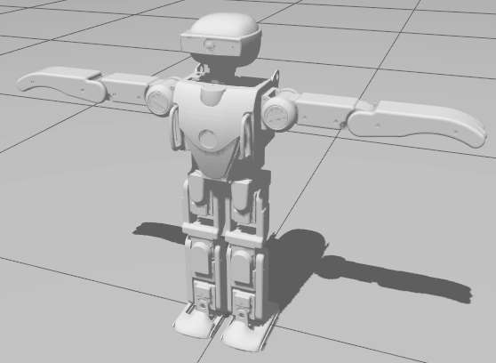

# muriqui_examples

## Setup and launch the Muriqui

Please refer to the [../README.md](../README.md) for instructions on how to setup the environment.

## Publish commands for all joints

Move all joints to the positions set in a CSV file.

Launch nodes using the following command:

```sh
ros2 launch muriqui_examples publish_joint_commands.launch.py
```

### Modify the CSV file

The CSV file is located in [muriqui_examples/config/joint_goals.csv](./config/joint_goals.csv).

If you want to add a new posture,
add a column to the right end of the CSV with the `goal_name` and `goal_positions`.

| group | joint       | all_zero | pose1 | pose2 | {goal_name }    |
| ----- | ----------- | -------- | ----- | ----- | --------------- |
| neck  | neck_joint1 | 0.0      | 0.6   | -0.6  | {goal_position} |
| neck  | neck_joint2 | 0.0      | 0.2   | -0.2  | {goal_position} |

### Images

all_zero:



pose1:


pose2:


## Notes

- The camera_info.yaml was generated according to the following calibration procedure:
  - https://rt-net.github.io/tutorials/cranev2/ros/camera-calibration.html
